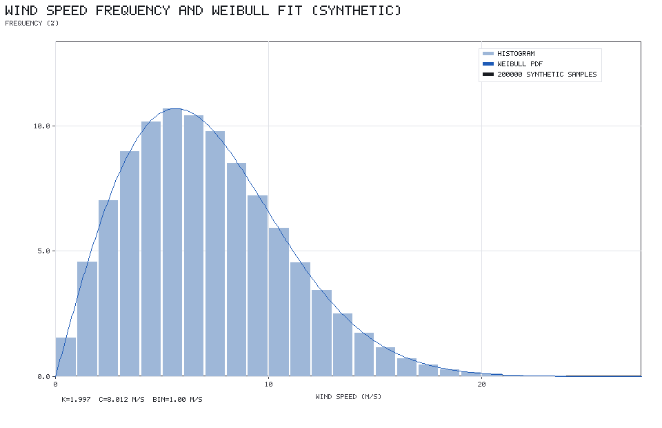
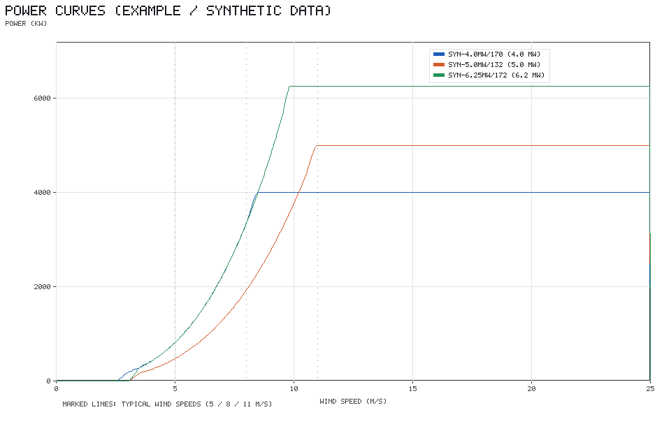
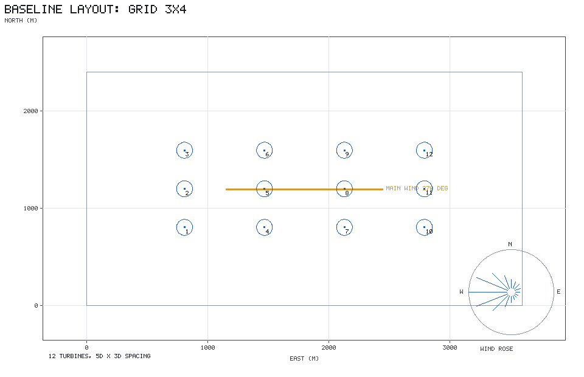
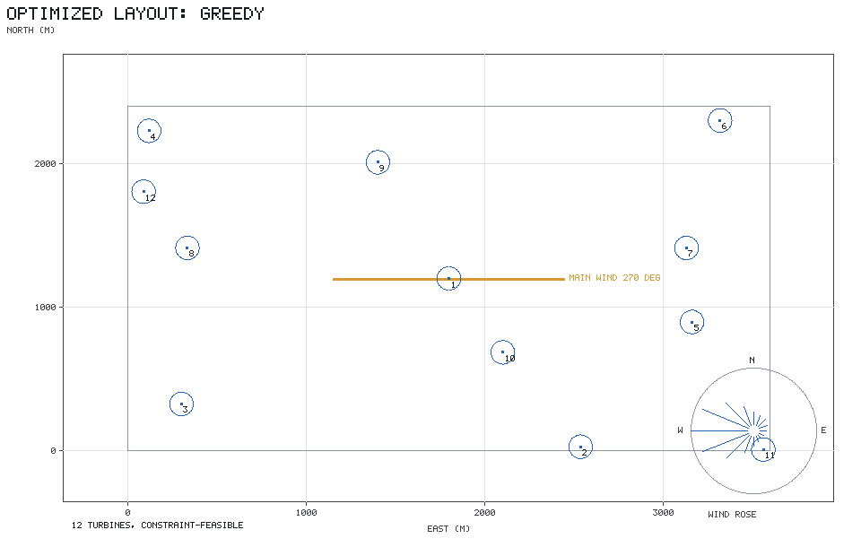
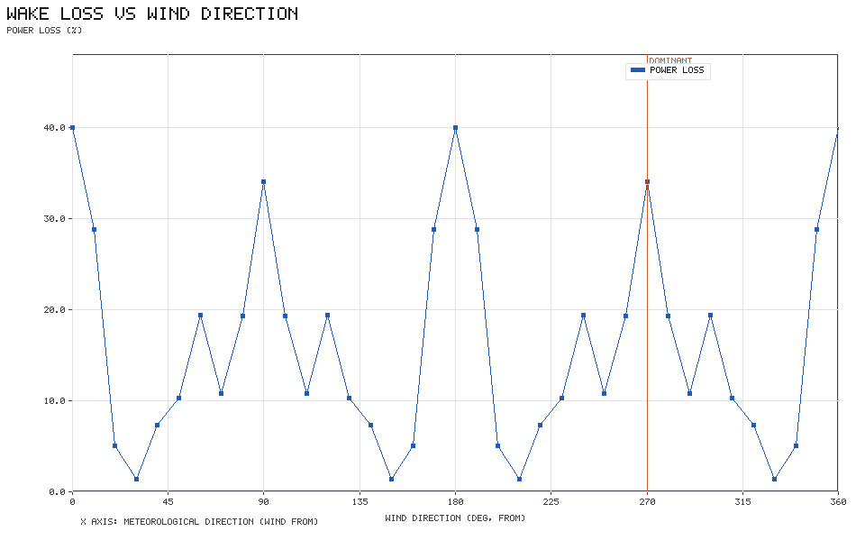
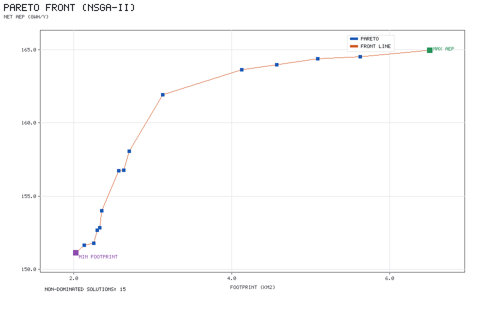
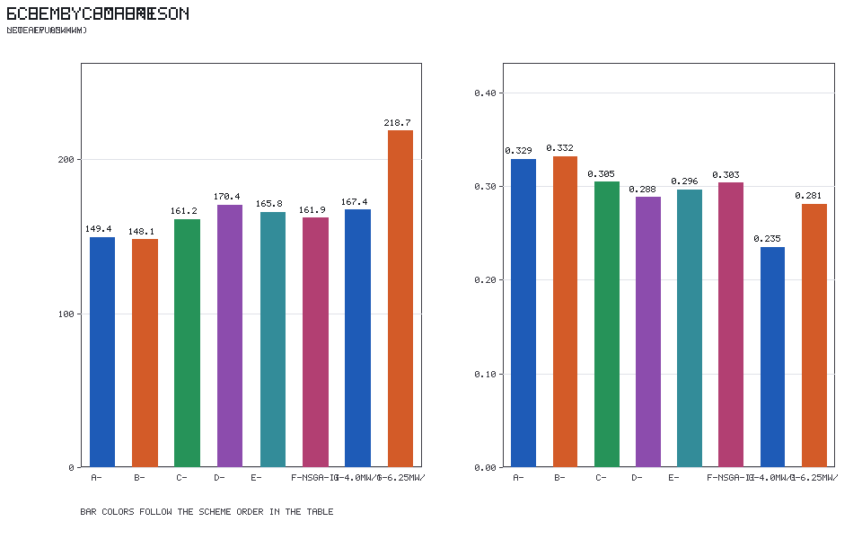
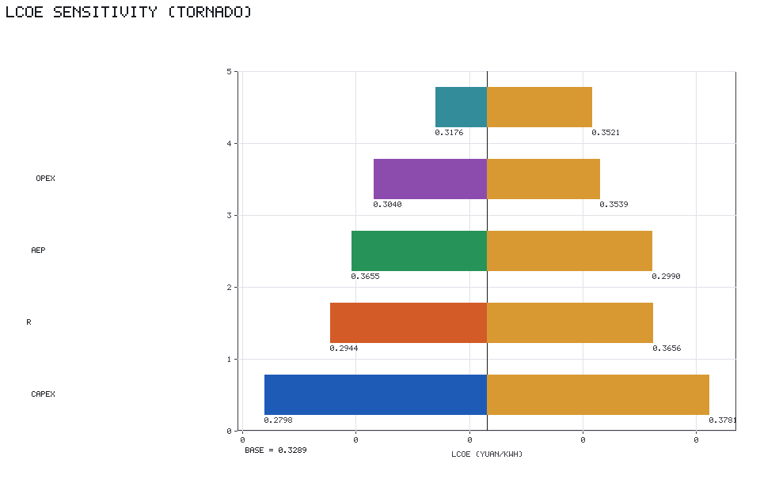
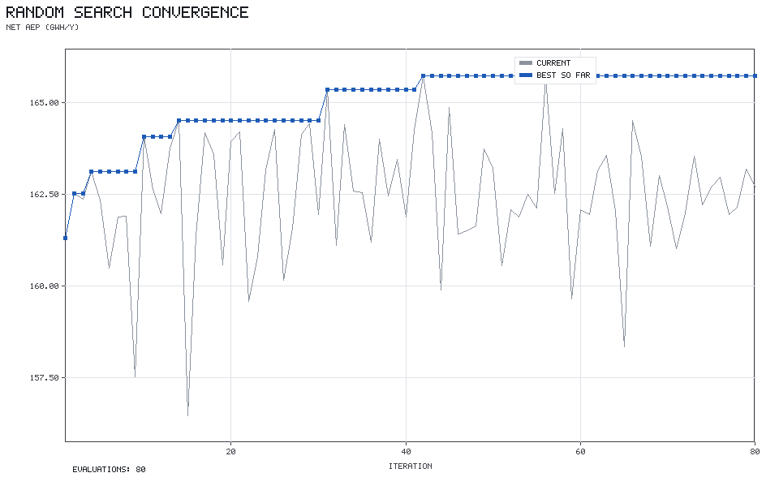

# wind-farm-planning-lab

**风电场方案设计与发电量评估工具**（Python，仅依赖 numpy）

用来回答售前场景里的核心问题：

> 给定风资源和场址约束，**哪种机型 + 哪种排布方案**的发电量和度电成本（LCOE）最优？

它把「Weibull 风资源 → 功率曲线 → Jensen 尾流 → 逐扇区发电量 → 经济性 → 多方案对比 → 排布优化」
这条链路做成**可复算的代码**，而不是一张 Excel 表或者一个说不清的口头结论。

```
风玫瑰（16 扇区）× Weibull 风速分布
        │
        ├─ 机型功率曲线（可导入真实曲线）
        │
        ├─ Jensen 尾流：风轮逐点离散 + 部分遮挡 + 平方和叠加 + 风向
        │
        ├─ 机位排布：网格 / 错列 / 随机 / 贪心优化 / NSGA-II
        │
        ▼
   逐扇区 × 逐风速仓的年发电量  ──►  容量系数、尾流损失、满发小时
        │
        ▼
   CAPEX / OPEX / LCOE / NPV / IRR / 回收期 / 敏感性
        │
        ▼
   方案对比表 + 非支配排序 + 竞争力判断 + Markdown/CSV/PNG 报告
```

---

## 快速开始

环境要求：**Python 3.8+**、numpy（**不需要 scipy / pandas / matplotlib**）。

```bash
pip install -r requirements.txt

python -m pytest tests -q      # 单元测试（257 个用例 / 630 条断言）
python scripts/demo.py         # 端到端示例，约 70 秒，产物写到 reports/
```

Windows PowerShell 下先设置编码（项目里全是中文注释与中文输出）：

```powershell
$env:PYTHONIOENCODING='utf-8'; $env:PYTHONUTF8='1'
python -m pytest tests -q
python scripts/demo.py
```

命令行入口：

```bash
python -m windlab.cli resource     # 打印示例风资源 + Weibull 拟合自检
python -m windlab.cli aep          # 算一个示例排布的发电量（含无尾流对照）
python -m windlab.cli compare      # 多机型 × 多排布方案对比
python -m windlab.cli optimize     # 排布优化（随机搜索 / 贪心 / NSGA-II）
```

也可以当库用：

```python
from windlab import example_wind_resource, example_curve, WakeModel, evaluate_aep
from windlab.layout import Site, grid_layout
from windlab.economics import Economics, lcoe

resource = example_wind_resource()          # 示例风资源（合成数据）
curve = example_curve()                     # 示例功率曲线（构造数据）
site = Site.rectangle(3600.0, 2400.0)       # 3.6 km × 2.4 km 场址
layout = grid_layout(site, 3, 4, 5 * curve.diameter, 3 * curve.diameter,
                     main_dir_deg=resource.dominant_direction_deg, margin=150.0)

wake = WakeModel(diameter=curve.diameter, k_wake=0.075, rotor_grid=20)
result = evaluate_aep(layout, resource, curve, wake,
                      availability=0.95, other_loss_factor=0.90, bin_width=1.0)
print(result.summary())

econ = Economics(capex_per_kw=5800.0, opex_per_kw_year=200.0,
                 discount_rate=0.08, lifetime_years=20, electricity_price=0.35)
print("LCOE = %.4f 元/kWh" % lcoe(econ, result.capacity_mw * 1000, result.net_gwh))
```

---

## 目录结构

```
wind-farm-planning-lab/
├── windlab/
│   ├── resource.py       Weibull 分布与参数拟合（矩估计 + MLE）、风频直方图、16 扇区风玫瑰
│   ├── power_curve.py    功率曲线：CSV 导入、示例曲线构造、PCHIP 保形插值、容量系数、Ct
│   ├── wake.py           Jensen 尾流 + 平方和叠加 + 风轮逐点部分遮挡 + 风向
│   ├── layout.py         场址几何、网格/错列/随机排布、椭圆间距约束检查与修复
│   ├── aep.py            逐扇区 × 逐风速仓发电量、尾流损失、容量系数
│   ├── economics.py      CAPEX/OPEX/LCOE/NPV/IRR/回收期/单因素敏感性
│   ├── compare.py        方案对比表、非支配排序 + 拥挤度、竞争力判断
│   ├── optimize.py       随机搜索 / 贪心加点 / 简化 NSGA-II（Pareto 前沿）
│   ├── report.py         Markdown + CSV + **手写 PNG**（自实现 PNG 编码与点阵绘图）
│   └── cli.py            命令行入口
├── scripts/
│   ├── demo.py               端到端示例（生成 docs/results.md 里的全部数字）
│   ├── convergence_check.py  分仓宽度 / 风轮离散的收敛性自检
│   └── stagger_check.py      错列 vs 网格 的逐扇区对照
├── tests/                10 个测试文件，含全部物理正确性锚点
├── docs/
│   ├── design.md         模型公式、数值约定、参数来源、踩过的坑
│   └── results.md        **真实跑出来的**方案对比与收敛性结果
└── reports/              demo 的产物（PNG / CSV / Markdown）
```

---

## 主要结论示例（示例场景，非真实项目）

场址 3.6 km × 2.4 km（8.64 km²）、12 台机组、场地平均风速 7.5 m/s、主风向西风：

| 方案 | 净AEP(GWh/年) | 尾流损失(%) | 净容量系数(%) | LCOE(元/kWh) |
|---|---|---|---|---|
| 规则网格 3×4（5.0MW/132m，基线） | 149.36 | 16.74 | 28.42 | 0.3289 |
| 错列排布 | 148.11 | 17.44 | 28.18 | 0.3317 |
| 随机撒点 | 161.24 | 10.12 | 30.68 | 0.3047 |
| **贪心优化排布** | **170.42** | **5.01** | 32.42 | 0.2883 |
| 低比功率机型（4.0MW/170m）网格 | 167.36 | 17.06 | **39.80** | **0.2348** |
| 大机型（6.25MW/172m）网格 | **218.70** | 16.91 | 33.29 | 0.2808 |

**同一场址、同样 12 个机位，仅靠优化排布就把 AEP 提高 14.1%、LCOE 降低 12.4%。**
机型选择的影响同样显著。完整数据（含逐扇区明细、敏感性分析、收敛性自检）见
[`docs/results.md`](docs/results.md)，这些数字全部由 `python scripts/demo.py` 生成，可复现。

还有一个反直觉的实测结论：**错列排布在本场景下反而更差**（−0.84%），
因为它把主风向的尾流打散的同时在 ±22.5° 相邻扇区制造了新的对齐，
而本例风玫瑰在这三个方向的频率几乎相同。详见 `docs/results.md` 第 6 节。

---

## 模型与实现要点

- **Weibull 拟合**：矩估计用二分法解 `1+CV² = Γ(1+2/k)/Γ(1+1/k)²`（比经验式 `(σ/μ)^-1.086` 更准）；
  MLE 用阻尼不动点迭代 `k = (Σv^k ln v / Σv^k − mean(ln v))^-1`。200000 样本能把参数还原到 0.2% 以内。
- **功率曲线**：Fritsch–Carlson 保形三次插值（自实现，无 scipy），额定风速精确插入采样点以保证额定段是常数；
  边界约定（切入以下 = 0、切出及以上 = 0）被测试覆盖。
- **尾流**：Jensen 模型 + Katic 平方和叠加 + 风轮 20×20 面积加权逐点离散，
  能算部分遮挡而不是「整台机全遮挡」；只有顺风方向产生尾流。
- **发电量**：逐扇区 × 逐风速仓，风速仓代表值取**能量等效风速**（不是仓中点），
  因此 4 m/s 粗分仓与 0.25 m/s 细分仓的 AEP 差异 < 0.2%，优化循环可以用粗分仓提速 12 倍。
- **LCOE**：标准折现现金流，并在无衰减情形下与等额年金闭式解 `CAPEX·CRF/AEP + OPEX/AEP` 对齐（测试断言 1e-12）。
- **多目标**：非支配排序 + 拥挤度（NSGA-II 选择算子的前两步）。
- **绘图**：自实现 PNG 编码（zlib + struct）与 5×7 点阵绘图引擎，**不依赖 matplotlib / Pillow**。

细节与取舍见 [`docs/design.md`](docs/design.md)。

---

## ⚠️ 明确不做的事 / 能力边界

这部分很重要，**请务必先读**。本项目是一个自学的方案评估工具，
**没有任何风电行业实际项目经验**，也没有做过任何真实风电场的验证或对标。

### 数据来源

| 项目 | 说明 |
|---|---|
| **内置功率曲线是示例曲线** | `SYN-4.0MW/170`、`SYN-5.0MW/132`、`SYN-6.25MW/172` 三条曲线全部是按「恒定 Cp + 额定限功率」模型**构造**的，用来演示形态，**不是任何厂商的实测数据，也不对应任何真实机型**。真实项目请用 `load_curve_csv` 导入厂商功率曲线。 |
| **推力系数 Ct 也是构造的** | 按变速变桨机组的典型形态（额定以下 0.75~0.85，额定以上按 `v^-2.5` 衰减到约 0.1）构造，非实测。 |
| **风资源数据是示例/合成数据** | 由双峰 von Mises 风玫瑰 + Weibull 分布生成，**不是实测测风塔数据，也不是再分析数据**。工具支持用 `speed_histogram` / `histogram_bins` 处理你自己的测风数据。 |
| **经济性参数是典型值** | 5800 元/kW、200 元/kW/年、8% 折现率、0.35 元/kWh 等均为**典型取值范围**，**不是任何实际项目的报价、中标价或电价**。 |
| **没有实测验证** | 没有用任何真实风电场的实测发电量、尾流测量或 SCADA 数据做过验证。项目里所有「结论」都只在这套合成输入下成立。 |

### 物理模型边界

- **尾流用 Jensen（Park）简化模型，不是 CFD。** 它只描述速度亏损随距离的工程近似，
  不含：地形与尾流在复杂地形上的偏转、大气稳定度、湍流强度与尾流恢复、
  偏航/尾流转向、机组间的控制协同、上游机组受尾流影响后 Ct 的变化
  （本工具用自由来流 Ct 近似，未做迭代耦合）。
- **近场精度差**：Jensen 模型在 2D 以内的近场不适用（本工具对合成亏损做了 0.99 截断保护）。
- **不做地形与测风塔外推**：所有机组同一轮毂高度、平坦地形、无坡度、无粗糙度变化，
  没有做测风塔到轮毂高度的风廓线外推（`α` 指数或对数律）。
- **没有湍流强度模型、没有 IEC 湍流等级校核、没有载荷与安全性评估。**
- **没有做发电量不确定性分析**（P50/P75/P90、长期订正、测量不确定度、损失不确定度）。
- **没有做电气设计**：集电线路、升压站、海缆、线损的详细建模——「其他综合折减系数」
  只是一个集总系数。
- **没有做限电/弃风建模**，也没有做电力市场、绿证、碳交易等收益机制。
- **经济性是简化模型**：没有做融资结构（贷款比例/利率/还款计划）、税收
  （增值税、所得税、折旧抵税）、通货膨胀、CAPEX 分期、退役费用、残值。
  IRR 用二分法求解，无解时返回 NaN。
- **间距约束是工程经验规则**（主风向 5D、横风向 3D 的椭圆禁区），不是厂商载荷规范要求。
- **排布优化是启发式**（贪心/随机搜索/简化 NSGA-II），不保证全局最优；
  优化目标固定为「固定机位数下的排布」，不做机位数与机型的联合优化。
- **LCOE 敏感性里没有电价**——这不是遗漏，而是 LCOE 的定义使然（成本口径，与售价无关）。

### 工程边界

- 仅支持 **16 扇区**风向；不支持多测风塔、多高度层数据的融合。
- 单一机型/单一场址的评估；不做多期建设、不做分区布置。
- `WakeModel` 的逐点离散带来 **±0.25% 量级的 AEP 数值不确定度**（见 `docs/results.md` 第 8.2 节），
  不影响方案排序，但不宜用来分辨 1% 以内的方案差异。
- 没有任何实盘/生产环境使用记录。

### 一句话总结

**这是一个把风电方案评估的标准方法链路完整实现出来、并用单元测试锚定物理正确性的自学项目。
它的价值在于「方法是透明的、数字是可复算的」，而不是「结论可以直接拿去投项目」。**

---

## 测试

```bash
python -m pytest tests -q        # 257 passed
python -m pytest tests -v        # 逐用例
```

覆盖的关键物理正确性锚点：

1. Weibull 拟合可还原（矩估计 + MLE，200000 样本误差 < 0.2%）
2. Weibull 分布归一化 `∫f(v)dv = 1`
3. 功率曲线边界（切入以下 = 0、切出及以上 = 0、额定段 = 常数）
4. Jensen 单机尾流解析解（手算 x=500 m、Ct=0.8、D=100 m、k=0.075 → 0.1805017）
5. 尾流单调性（下游距离越大亏损越小、Ct 越大亏损越大）
6. 无尾流时 AEP = 功率曲线 × 风频的期望（手算 + 细网格数值积分双重验证）
7. LCOE 闭式验证（等额年金 CRF 与逐年折现现金流一致，误差 < 1e-12）
8. 排布约束能识别违规（椭圆禁区 + 绝对最小间距 + 越界）
9. 风向影响（顺排 vs 垂直，尾流损失差异显著且顺排更大）
10. 非支配排序符合构造好的已知偏序关系（并与暴力法对拍）

索引见 `docs/design.md` 第 10 节。

---

## 许可

MIT（见 `LICENSE`）。代码可自由使用，但请自行承担数据与结论的适用性判断——
本工具的输出**不构成任何投资或工程建议**。

---

## 结果图表（由 `python scripts/demo.py` 实际生成）

以下图全部来自示例数据的一次真实运行，可在本地用 `python scripts/demo.py` 复现。

| 图 | 说明 |
| --- | --- |
|  | 风速频率分布与 Weibull 拟合 |
|  | 三条示例机型的功率曲线与 Ct 曲线 |
|  | 基准（规则网格）排布与主风向 |
|  | 贪心优化后的排布 |
|  | 逐风向扇区的尾流损失 |
|  | AEP 最大 vs 占地最小的非支配解集 |
|  | 8 个方案的 AEP / LCOE 对比 |
|  | LCOE 单因素敏感性（龙卷风图） |
|  | 排布优化的收敛过程 |

> ⚠️ 再次强调：图的输入是**示例/合成数据**，不代表任何真实风电场。
